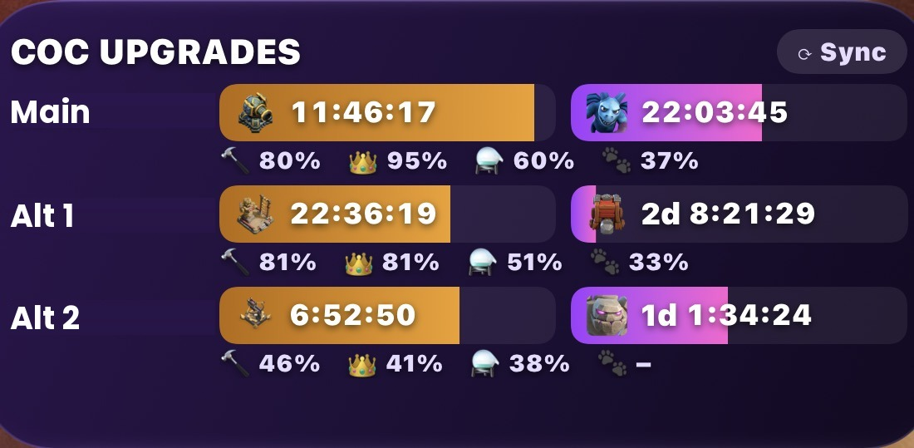
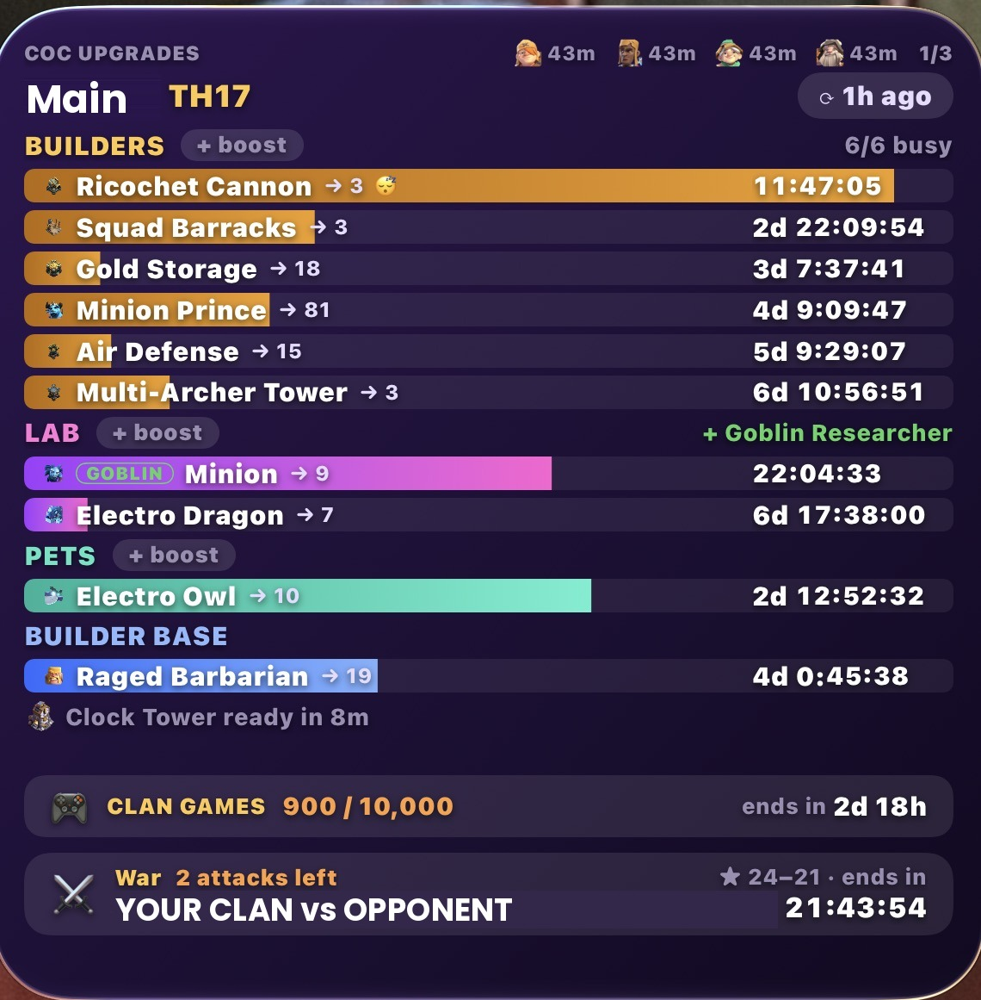
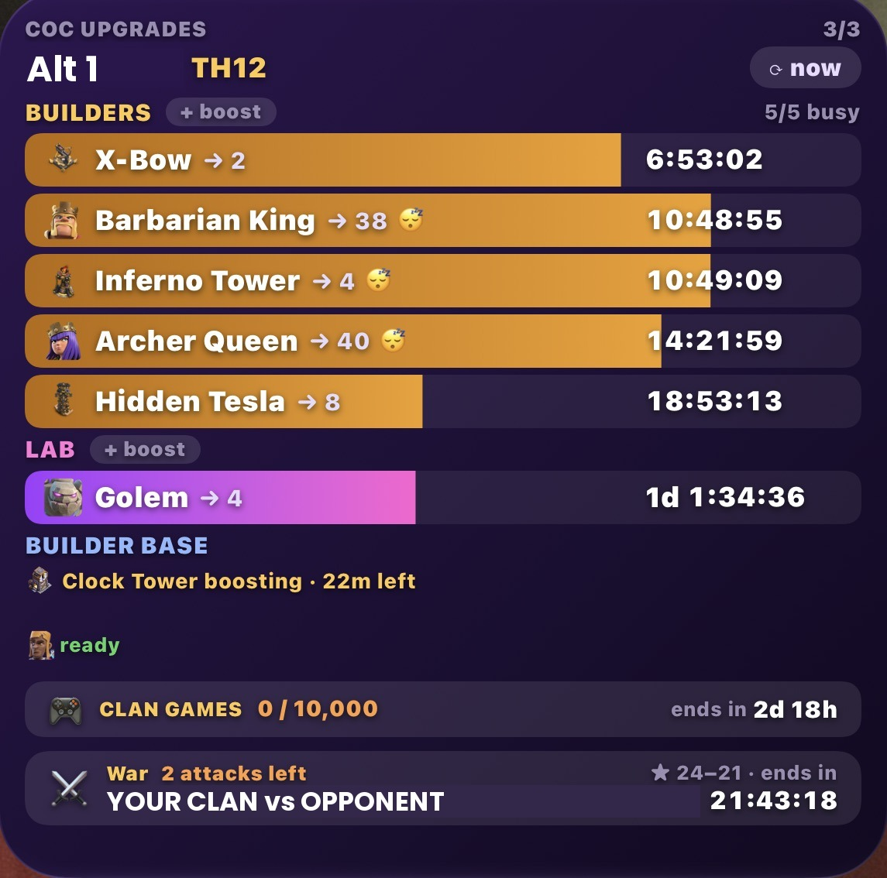

# COC Upgrade Tracker

A single-file [Scriptable](https://scriptable.app) script for iPhone that tracks
your Clash of Clans upgrades for **several accounts at once**. It shows a
home-screen widget and sends a notification the moment each upgrade finishes.
No server and no login: everything runs on your phone.

## Features

- Builders, laboratory, pets, heroes, Builder Base, Clock Tower and helpers, for every account
- Notifications at the exact moment an upgrade finishes, plus a "builders idle" alert
- Small, medium and large widgets, with several themes and progress-bar styles
- Time reductions (Hammer Jam / Summer Jam events and the Gold Pass boost), so progress bars stay correct
- Progress to max for builder, heroes, lab and pets
- Sleep-aware alerts: a reminder before bedtime if something is about to go idle
- Clan Games points per account, with alerts
- Raid Weekend attacks left, plus war status
- Town Hall 19 supported

## Widgets: overview or detail

The same script draws two kinds of widget. You choose with the **Widget Parameter** (Scriptable widget → Edit → Parameter).

### Overview widget (medium) — all accounts at a glance

Leave the Parameter **empty**. You get one row per account: the next builder to finish, the lab timer,
and the progress to max (🔨 builder, 👑 heroes, ⚗️ lab, 🐾 pets). Best for the medium size.

### Detail widget (large) — one account, every upgrade

Put an **account name** in the Parameter (for example `Main`). You get that account only, with every
builder, lab and pet upgrade, the Builder Base and Clock Tower, Clan Games points and the current war.
Add one widget per account. Best for the large size.

### Differences

| | Overview (medium) | Detail (large) |
|---|---|---|
| Widget Parameter | empty | account name, e.g. `Main` |
| Accounts shown | all | one |
| Upgrades listed | next builder + lab timer | every builder, lab, pet and Builder Base upgrade |
| Extras | progress to max per account | Clock Tower, Clan Games and war lines |

You can also pick a theme and progress style in the Parameter, separated by commas, for example `Main, elixir, bars`.
The account names in the screenshots (Main, Alt 1, Alt 2) are placeholders. You rename your own accounts from the script menu.

## Install

1. Install **Scriptable** from the App Store.
2. In Scriptable press **+**, paste the contents of `COC Tracker.js`, and name the script (for example `COC Tracker`).
3. In Clash of Clans open **Settings → More Settings → Data Export → Copy**.
4. Run the script in Scriptable. It imports the export from the clipboard and shows a menu.
5. Add a Scriptable widget to the home screen and choose this script. The optional Widget Parameter is an account name, which shows only that account.

## Keeping it up to date automatically

Create a Shortcuts automation: **When "Clash of Clans" is closed → Run Script "COC Tracker"**.
After you copy a new export, the script imports it silently the next time it runs.

## Notes

- Your data (player tags, settings) stays in the Scriptable folder on your device and is never uploaded.
- War, raid and Clan Games data come from the official API through ClashKing's free proxy.
  You can optionally add your own Clash API key (menu → Backup API key), used via RoyaleAPI's proxy.
- Clan Games points are counted from the "Games Champion" total, so the very first Games after you install
  may need a one-time entry from the menu.

## Credits and disclaimer

Item pictures, game data and the free API proxy are by [ClashKing](https://clashk.ing).
Optional API-key route through RoyaleAPI's proxy.

This is an unofficial fan project. This material is unofficial and is not endorsed by Supercell.
For more information see [Supercell's Fan Content Policy](https://www.supercell.com/fan-content-policy).

Released under the MIT License.
